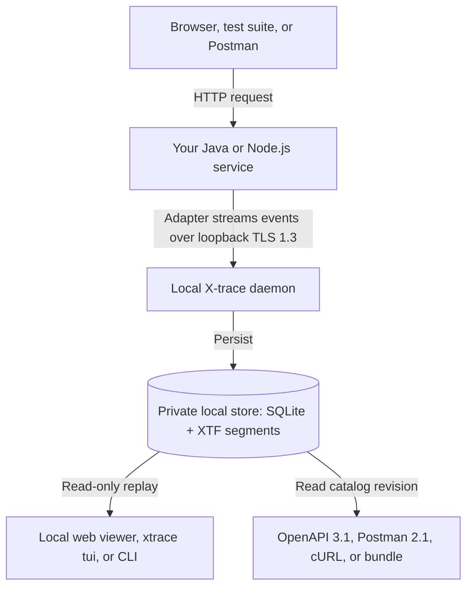

# X-trace

[](https://github.com/Legend101Zz/X-trace/actions/workflows/ci.yml?query=branch%3Amain)
[](https://github.com/Legend101Zz/X-trace/releases/tag/v0.0.1)
[](https://github.com/Legend101Zz/X-trace/releases)
[](LICENSE)

**Follow an HTTP request through your backend, one recorded call at a time.**

X-trace is a local, privacy-first execution recorder for **Java** and **Node.js** backends. Send a request from your browser, test suite, or Postman, then open the saved recording in a local web viewer or your terminal to walk through the exact code path that ran—without scattering `console.log` statements or pausing your server on breakpoints.

[Why I built this](#why-i-built-x-trace) · [See it in action](#see-it-in-action) · [Install](#installation) · [Quickstart](#quickstart) · [How it works](#how-it-works) · [Supported stacks](#supported-stacks) · [Privacy](#privacy--local-first-security)

---

## Why I built X-trace

Jumping into a new backend codebase can be genuinely frustrating.

You open a repo with hundreds of files, hit an endpoint like `POST /orders`, and suddenly you're playing detective across controllers, middleware, filters, services, repositories, and shared helpers. Reading the code statically only gets you so far—interfaces have multiple implementations, middleware runs implicitly, and it's surprisingly hard to be sure *which* code actually handled the request you just sent.

What really opened my eyes was using **IntelliJ IDEA** on Java codebases. Seeing how smoothly IntelliJ lets you trace call hierarchies, step through live execution, and inspect what is actually happening inside a running app completely changed how quickly I could understand unfamiliar code. It turned a wall of files into a clear story.

I wanted that same feeling—**understanding a real codebase by watching an actual request flow through it**—in a lightweight tool that works across **both Java and Node.js**, stays completely local, and doesn't require setting up a dozen breakpoints every time you want to answer a simple question:

> *"I just sent this HTTP request. What actually ran, in what order, and why did it behave that way?"*

### Why it's useful day to day

- **Faster onboarding to unfamiliar repos:** Send a real request and immediately see the real controller, service, repository, and database/HTTP calls it touched—no guesswork.
- **Debugging without the breakpoint dance:** You don't have to freeze live traffic or guess where to put breakpoints up front. Record the request once, stop your server if you want, and step forward and backward through the saved execution at your own pace.
- **Clearer than ad-hoc logs:** Instead of adding temporary print statements, restarting, and cleaning them back up, you get an ordered execution timeline linked straight to your source code.
- **Built to work with Postman and your existing workflow:** Send requests from Postman, curl, or your frontend—then inspect the backend path in X-trace. You can also export discovered endpoints straight out to OpenAPI, Postman, or cURL.

---

## See it in action

Here is what stepping through a real **Spring Petclinic** request looks like in the local viewer—moving through the request timeline, seeing the exact Java source line light up alongside the Evidence inspector, exploring the call Map, and previewing exports:


**[Watch the full walkthrough video (`xtrace-demo.mp4`)](docs/demo/xtrace-demo.mp4)**

| Step through code & evidence | Explore the call Map | Export to OpenAPI, Postman, or cURL |
| --- | --- | --- |
|  |  |  |

If you'd rather stay in the terminal, **`xtrace tui`** lets you browse and step through the exact same recordings with your keyboard (`↑/↓`, `[ ]`, `i / o / u`):

```text
X-trace · recordings
> 01a21ef1-f889-7e2f-9b4b-b67a1dd050f4  complete  329 events  GET /vets               responded
  01a21ef1-f5ef-7d58-a021-07fe615eba18  complete  122 events  GET /owners/{ownerId}   responded
  01a21ef1-f2e3-79d2-a5e0-5bab33cbec95  complete   75 events  POST /owners/new        responded
  01a21ef1-eaa1-7aea-a21d-d0bb95c9c9ab  complete  157 events  GET /owners             responded
```

---

## A concrete example

Take two requests to the exact same `POST /orders` endpoint in the built-in [Spring fixture](adapters/java/spring-fixture/src/main/java/dev/xtrace/fixture):


Both hit `POST /orders`, but one flows all the way to the repository and database while the other throws in the service layer. With X-trace, both runs are saved locally so you can open each one and see exactly where they diverged.

---

## Installation

### Pre-built `v0.0.1` archives (macOS Apple Silicon & Linux x86_64)

Download the tarball and `SHA256SUMS` for your platform from the **[v0.0.1 Pre-release](https://github.com/Legend101Zz/X-trace/releases/tag/v0.0.1)**, extract it, and run `./install.sh`:

```sh
# Pick your platform: macos-arm64 or linux-x86_64
PLATFORM="macos-arm64"   # or "linux-x86_64"
VERSION="0.0.1"

# Extract and install into ~/.local/xtrace (or pass --prefix /your/path)
tar -xzf "xtrace-${VERSION}-${PLATFORM}.tar.gz"
cd "xtrace-${VERSION}-${PLATFORM}"
./install.sh install

# Add X-trace to your PATH (install.sh never edits your shell profile automatically)
export PATH="$HOME/.local/xtrace/bin:$PATH"
xtrace --version
```

> **Early preview note:** Both `v0.0.1` preview archives (`macos-arm64` and `linux-x86_64`) are currently unsigned and not notarized. On macOS, if your browser adds a quarantine flag to the downloaded archive, run `xattr -dr com.apple.quarantine xtrace-0.0.1-macos-arm64.tar.gz` before extracting. You can remove X-trace cleanly anytime with `./uninstall.sh`.

### Building from source

Requires **Rust** (stable, per `rust-toolchain.toml`), a C compiler, **JDK 17+**, and **Node.js 22 or 24**.

```sh
git clone https://github.com/Legend101Zz/X-trace.git
cd X-trace

# Build a local package for your machine
python3 packaging/build.py --out dist
sh packaging/install.sh verify-dist dist/*

# Or run the CLI directly during development
cargo run --locked -p xtrace-cli --bin xtrace -- --help
```

See [tools/dev/README.md](tools/dev/README.md) and [docs/development/setup.md](docs/development/setup.md#experimental-xtrace-run) for development setup and caches.

---

## Quickstart

### 1. Initialize your project once

Point X-trace at your application directory. This writes a tiny `.xtrace/config.toml` pointer in the repo while keeping all recordings in your private X-trace data directory (`XTRACE_DATA_HOME`).

```sh
project_dir="/absolute/path/to/your/app"
xtrace init --project-dir "$project_dir" --display-name "My Service"
```

### 2. Run your backend with X-trace

Launch your service through `xtrace run`, send normal traffic from your browser, tests, `curl`, or Postman, and press `Ctrl+C` when you're done. X-trace flushes and saves in-flight recordings cleanly on shutdown.

#### Java (Spring MVC, Spring WebFlux, Servlet, Jersey / JAX-RS)

```sh
xtrace_home="$HOME/.local/xtrace/current"

# Optional: scan routes statically so endpoint grouping & exports work right away
xtrace scan --project-dir "$project_dir" --source "$project_dir/src/main/java" --framework spring-mvc
# Using JAX-RS / Jersey (jakarta.ws.rs or javax.ws.rs)? Pass: --framework jaxrs

# Run with focused capture to record executed source lines & bounded local values
xtrace run --project-dir "$project_dir" \
  --java-agent "$xtrace_home/share/xtrace/packs/java/agent/xtrace-java-agent.jar" \
  --capture-depth focused \
  --app-package com.example.myapp \
  --source-root src/main/java -- \
  java -jar target/myapp.jar
```

#### Node.js (Node 22–24: HTTP, Express 4/5, Fastify 4/5, NestJS, PostgreSQL, MySQL, Outbound HTTP)

```sh
xtrace_home="$HOME/.local/xtrace/current"

xtrace run --project-dir "$project_dir" \
  --node-adapter "$xtrace_home/share/xtrace/packs/node/dist" \
  --node-mode auto -- \
  node dist/server.js
```

*(If you passed a custom `--prefix` to `./install.sh`, set `xtrace_home="<your-prefix>/current"`.)*

### 3. Open your recordings

```sh
# Local web viewer (Steps, Map, Code, Evidence, Export)
xtrace open --project-dir "$project_dir" --viewer

# Interactive terminal viewer (add --plain for plain text output)
xtrace tui --project-dir "$project_dir"

# JSON listing from the CLI
xtrace recording list --project-dir "$project_dir"
```

> **Note:** `xtrace open --viewer` runs in the foreground and prints a short-lived, single-use `http://127.0.0.1:...` URL. Keep that terminal open while browsing, and treat the URL like a temporary local credential.

### 4. Export OpenAPI, Postman, cURL, or a Developer Bundle

Preview first, then write into a fresh private (`0700`) directory:

```sh
xtrace export --project-dir "$project_dir" --format postman --preview

export_dir="$(mktemp -d)" && chmod 700 "$export_dir"
xtrace export --project-dir "$project_dir" --format bundle --output "$export_dir"
ls -la "$export_dir"
```

Available formats: `openapi` (OpenAPI 3.1), `postman` (Collection v2.1), `curl` (shell recipes), and `bundle` (all three plus a manifest with file hashes and counts).

---

## How it works



A core design goal of X-trace is **never guessing**. If something wasn't observed, the viewer tells you plainly rather than filling in the blanks:

| What you see | What it means |
| --- | --- |
| **Captured call** | The adapter actually observed that method or handler run during this request. Statically discovered routes are clearly kept separate from observed calls. |
| **Highlighted source line** | A line event was recorded (`--capture-depth focused` on Java). Standard method capture shows the method without claiming which exact line ran. |
| **Value or omission** | Focused Java capture records bounded values inside your `--app-package` scope. Anything redacted, truncated, or unavailable is disclosed explicitly. |
| **Partial recording** | Something interrupted capture (like killing the server mid-request or hitting an untransformed class). Every event that *was* captured stays readable, with gaps called out honestly. |

More details in [Architecture](docs/plans/x-trace/02-architecture.md) and [Recording limitations (ADR 0011)](docs/decisions/0011-recording-limitations.md).

---

## Supported stacks

| Runtime | Frameworks & interactions | Static scan & exports | Source lines & values |
| --- | --- | --- | --- |
| **Java 17 & 21** | Spring MVC, Spring WebFlux, Servlet, Jersey / JAX-RS, JDBC (including PostgreSQL) | `spring-mvc` & `jaxrs` (`jakarta.ws.rs` / `javax.ws.rs`) → OpenAPI 3.1, Postman 2.1, cURL, Bundle | Method-level (standard) + executed lines & bounded local values (`--capture-depth focused`) |
| **Node.js 22 & 24** | `node:http`, Express 4 & 5, Fastify 4 & 5, NestJS, PostgreSQL (`pg`), MySQL (`mysql`/`mysql2`), outbound HTTP/`fetch`, worker & child-process linkage | Planned for upcoming release | Request, framework, DB, and outbound frames captured today; source lines & values honestly disclosed as unavailable |

### How X-trace fits alongside Postman

- **Building requests, tweaking payloads, and asserting responses?** Use **Postman**.
- **Want to know which controller, service, repository, or query handled that request?** Open the recording in **X-trace**.
- **Using both together:** Fire requests from Postman against your running instrumented service, inspect the real code flow in X-trace, or export a fresh `collection.postman.json` (with an empty `baseUrl` variable and zero captured secrets) straight into Postman.

---

## Privacy & local-first security

Real codebases have real tokens, cookies, and passwords flying around locally. X-trace is built so they stay on your machine and out of your exports:

- **100% local on loopback:** No cloud accounts, no telemetry, no outbound calls. The viewer binds strictly to `127.0.0.1`.
- **Pinned local TLS:** Adapters talk to the local daemon over TLS 1.3 with per-session authentication.
- **Private permissions by default:** Project stores and export directories enforce `0700` directories and `0600` files, refusing world-writable locations.
- **Clean exports:** Request bodies, `Authorization` headers, cookies, and query secrets are excluded from exported OpenAPI, Postman, cURL, and bundle files.
- **Automated leak checks:** Real-app test runs inject synthetic secret canaries across headers, cookies, query params, JSON bodies, and env vars and verify they don't leak into persisted stores, logs, API responses, DOM snapshots, or exports.

See [Local security model](docs/security-local.md) for the full details.

---

## Release status

X-trace is currently in **`v0.0.1` Early Preview** for **macOS Apple Silicon (`macos-arm64`)** and **Linux (`linux-x86_64`)**.

### Tested against real open-source apps

- **Java:** Verified end-to-end on **Spring Petclinic** (45/45 checks green, ~1.16× p50 overhead, focused lines & values, all 4 exports, web viewer & TUI, zero leaks), plus multi-module runs on **JHipster v9.4.0** (38 exported ops) and **Apache Fineract 1.15.0** (675 JAX-RS ops exported via `--framework jaxrs`).
- **Node.js:** Verified end-to-end on **Directus** (Node 22), **Medusa** (Node 24), and **Vendure** (Node 24) with matching response/database behavior, zero dropped requests on shutdown, and working web viewer replay.

### What's coming next

- **Node.js source lines & static route scanning:** Source-map-backed file/line locations and static route exports for Express, Fastify, and NestJS.
- **Even stronger Java transform coverage:** Closing remaining optional-class transform gaps on large multi-module codebases like Fineract and JHipster.
- **Formal signed `0.0.1` acceptance:** Completing the owner walkthrough, usability sessions, and Ed25519 release signing tracked in [Issue #1](https://github.com/Legend101Zz/X-trace/issues/1) and [evidence/v0.01/requirements.json](evidence/v0.01/requirements.json).

---

## Frequently asked questions

**Does stepping backward in the viewer re-send my HTTP request?**
No. Replaying a recording is completely read-only against your local SQLite + XTF store. You can safely inspect `POST` or `DELETE` calls even after stopping your backend.

**Why does a recording say `Partial`?**
X-trace never pretends an incomplete capture is complete. You'll see `Partial` if the app exited mid-request, if an event buffer hit its memory limit, or if a class couldn't be instrumented. Click **Why?** in the viewer for the exact reason.

**Where are recordings stored, and how do I clean them up?**
Your repo only gets `.xtrace/config.toml` (feel free to add `.xtrace/` to `.gitignore`). Recordings live separately under `$XTRACE_DATA_HOME` (or your OS user data directory by default). Delete that project directory anytime to wipe recordings cleanly.

---

## Project documentation

- [Product design](docs/plans/x-trace/01-product.md) — workflow goals and replay concepts
- [Architecture](docs/plans/x-trace/02-architecture.md) — daemon, XTP transport, XTF storage, and adapters
- [Local security model](docs/security-local.md) — loopback TLS, permissions, and privacy guarantees
- [Developer setup & build tools](tools/dev/README.md) — local prerequisites, caches, and verification commands
- [Release specification (`v0.01`)](docs/releases/v0.01.md) — platform, runtime, and evidence commitments
- [Owner review checklist](docs/owner-review/README.md) — manual walkthrough journeys
- [Full documentation index](docs/INDEX.md) — schemas, protocol specs, viewer API, and ADRs

---

## License

X-trace is open-source software licensed under the [MIT License](LICENSE).
