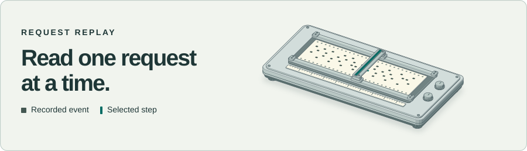
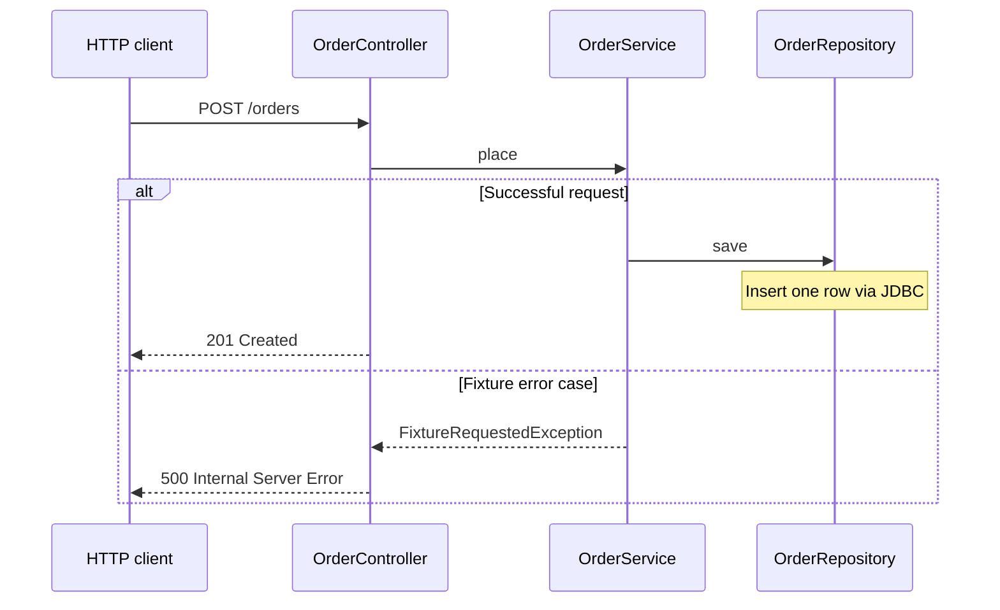
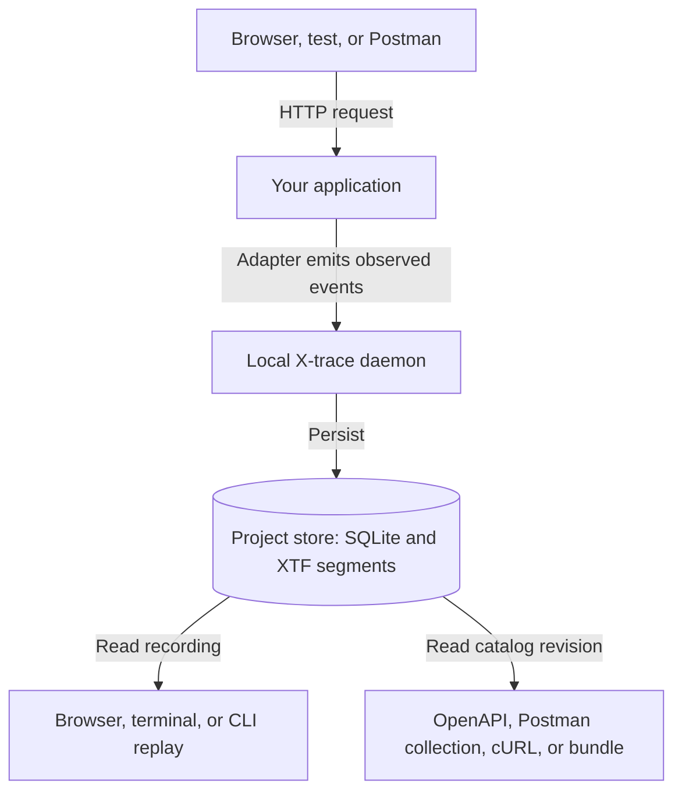

# X-trace

[](https://github.com/Legend101Zz/X-trace/actions/workflows/ci.yml?query=branch%3Amain)
[](docs/releases/v0.01.md)
[](LICENSE)

**Follow an HTTP request through your backend, one recorded call at a time.** X-trace is a local development tool for Java and Node.js applications. Send a request from a browser, a test, or Postman, then open its recording to see which handler ran, which calls followed, and what outcome the adapter observed.

**Release status.** The first public release, **0.0.1**, is in development. Spring MVC on Petclinic has the strongest end-to-end evidence today. There is no published installer yet. [Release status and scope](#release-status) · [Try it from source](#try-it-from-source)



## What problem does it solve?

An endpoint list can tell you that `POST /orders` exists. A response can tell you it returned `201`. When you're new to a codebase, the harder question is **which code actually handled this request?** The route definition, service, repository, and error handler can live in different files. A recording gives you one execution to follow after the request has finished.

The repository includes a small Spring application that makes this concrete. On a successful order, its controller calls a service, the service calls a repository, and the repository inserts a row through JDBC. Its error case returns `500` from the controller after a service exception. Those two requests reach the same endpoint and take different paths. [Fixture source](adapters/java/spring-fixture/src/main/java/dev/xtrace/fixture) · [Capture journey](crates/xtrace-cli/tests/java_premain_spring.rs)



## What does a recording show?

Choose a request in the local viewer and step through its events. **Linear** displays them in order. **Canvas** shows their recorded relationships. The terminal viewer and CLI also read saved recordings. You can reopen a recording after stopping the application.

| In the viewer | How to read it |
| --- | --- |
| A captured call | The adapter observed that call during this request. A route found by a static scan alone says only that the route was discovered. |
| A highlighted source line | The recording contains a line event. Method-level capture can identify a method without identifying the exact line that executed. |
| A value or an omission | Focused Java capture can include bounded values from the selected application scope. Redaction, truncation, and unavailable source are disclosed where applicable. |
| A partial recording | Some evidence is missing. You can inspect the captured events while leaving the missing steps open. |

The application adapter sends events to the local X-trace daemon. The daemon persists them in the project store. Viewing the recording reads that stored evidence; stepping backward does not send the original HTTP request again. [Architecture](docs/plans/x-trace/02-architecture.md) · [Recording limitations](docs/decisions/0011-recording-limitations.md)



## How does X-trace fit with Postman?

| Question | Where to start |
| --- | --- |
| What happens if I send this payload or change a header? | **Postman.** Build and send the request, inspect the response, and write assertions against it. |
| Which application method handled that particular request? | **X-trace.** Open the recording for your instrumented local service and inspect the observed calls, source evidence, and outcome. |
| How can I repeat a case and explain a surprising result? | **Use both.** Keep the request and response assertions in a Postman collection. Send it to the running instrumented application, then inspect the resulting recording in X-trace. |

You can also go from X-trace to Postman. With a persisted catalog revision, export a local Collection v2.1 file, import `collection.postman.json` into Postman, and set its empty `baseUrl` variable to your local service. The export contains request templates. Captured request bodies and credentials are excluded. [Postman request and response guide](https://learning.postman.com/docs/use/send-requests/requests) · [Postman collections](https://learning.postman.com/docs/use/send-requests/create-requests/intro-to-collections) · [X-trace collection exporter](crates/xtrace-export/src/postman.rs)

## Try it from source

Start in the X-trace checkout on macOS or Linux. The following commands use Rust and a C compiler to build the CLI and display its options.

```sh
cargo run --locked -p xtrace-cli --bin xtrace -- --help
cargo run --locked -p xtrace-cli --bin xtrace -- run --help
```

**For your first recording**, follow the Spring fixture walkthrough. It covers building the Java agent and fixture, initializing a project, and launching the application through X-trace. Send the request while the application is running. An initialized project stays empty until a request is captured. [Spring fixture walkthrough](docs/development/setup.md#experimental-xtrace-run) · [Build environment](tools/dev/README.md)

**To inspect an existing recording**, set the path to the application repository you initialized. The viewer command prints a short-lived, single-use local URL and runs in the foreground. Open the URL in your browser and keep the terminal open.

```sh
project_dir="/absolute/path/to/your/recorded-project"
cargo run --locked -p xtrace-cli --bin xtrace -- recording list --project-dir "$project_dir"
cargo run --locked -p xtrace-cli --bin xtrace -- open --project-dir "$project_dir" --viewer --no-browser
```

**To export a collection**, use a project with a saved catalog revision. Preview the files, then write them into a fresh private directory. Import the resulting file into Postman and set its collection variables before sending.

```sh
cargo run --locked -p xtrace-cli --bin xtrace -- export --project-dir "$project_dir" --format postman --preview
export_dir="$(mktemp -d)"
cargo run --locked -p xtrace-cli --bin xtrace -- export --project-dir "$project_dir" --format postman --output "$export_dir"
printf 'Collection file: %s/collection.postman.json\n' "$export_dir"
```

Recordings live in the local X-trace data directory. The application repository holds its project pointer at `.xtrace/config.toml`. Treat the viewer URL as a temporary credential. [Local security model](docs/security-local.md)

## Release status

The roadmap calls this release **v0.01**. Its package version is **0.0.1**. As of November 19, 2026, the project has no selected release candidate. All 55 mandatory requirements still await formal acceptance. [Release tracker](https://github.com/Legend101Zz/X-trace/issues/1) · [Acceptance ledger](evidence/v0.01/requirements.json) · [Published releases](https://github.com/Legend101Zz/X-trace/releases)

| Area | Demonstrated or implemented | Remaining for release |
| --- | --- | --- |
| Java | A packaged build captured Spring MVC requests in Petclinic. Checks exercised source identity, executed lines, frame values, and reopening recordings. | Shutdown reliability, WebFlux and Servlet/Jersey coverage, and verification across launch and attach configurations. |
| Node.js | The adapter implements Node HTTP and Express instrumentation. | Fastify, NestJS, authored TypeScript sources, database and outbound interactions, and worker/child-process linkage. |
| Replay and export | Petclinic exercised Linear, Canvas, the terminal viewer, and all four local export formats. | Catalog history and conflicts, overlapping routes in exports, accessibility, and performance. |
| Distribution | Linux CI builds and checks development packages. | Six packaged application campaigns, fresh installs on Linux x86_64 and macOS arm64, usability sessions, and owner acceptance. |

**Evidence from two different commits.** The Petclinic campaign at `7448048` passed 37 of 45 checks. Eight recorded limitations, including how load and overhead were measured. On `main` commit `be441c5`, the JDK 21 / Node 24 Linux configuration passed 23 of 23 release checks. The JDK 17 / Node 22 configuration and the main unit and integration job failed. The CI badge above tracks subsequent pushes to `main`. [Petclinic campaign](https://github.com/Legend101Zz/X-trace/actions/runs/43201696564) · [CI on be441c5](https://github.com/Legend101Zz/X-trace/actions/runs/43214553598)

## Project documentation

- [Product design](docs/plans/x-trace/01-product.md) describes the intended endpoint-to-source workflow.
- [Development tools](tools/dev/README.md) covers dependencies, build caches, and local checks.
- [Release specification](docs/releases/v0.01.md) lists the runtime, platform, and usability commitments.
- [Documentation index](docs/INDEX.md) links the storage format, protocol, viewer API, and design decisions.

X-trace uses the [MIT license](LICENSE).
