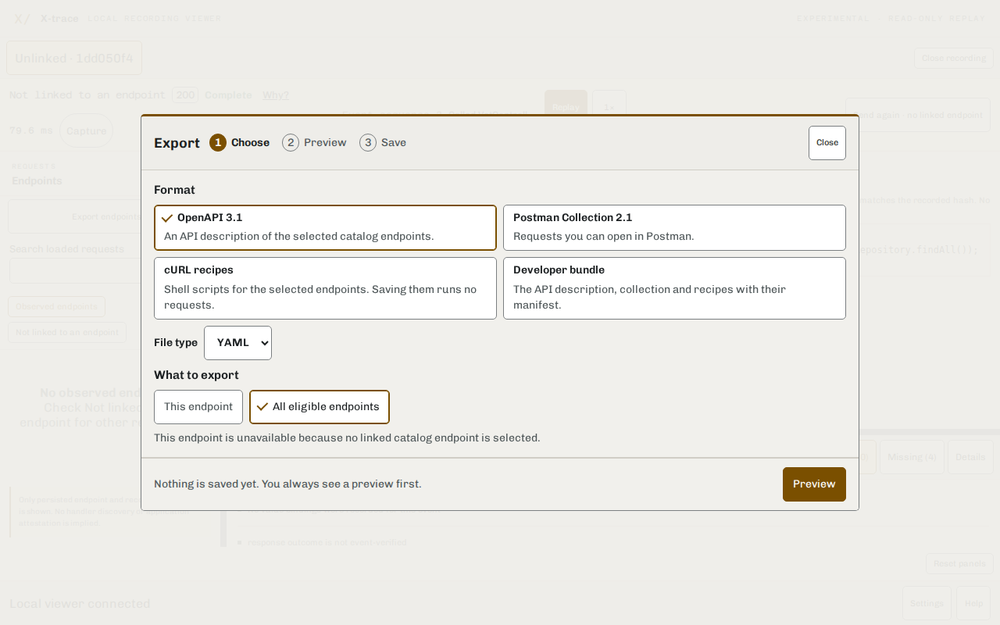
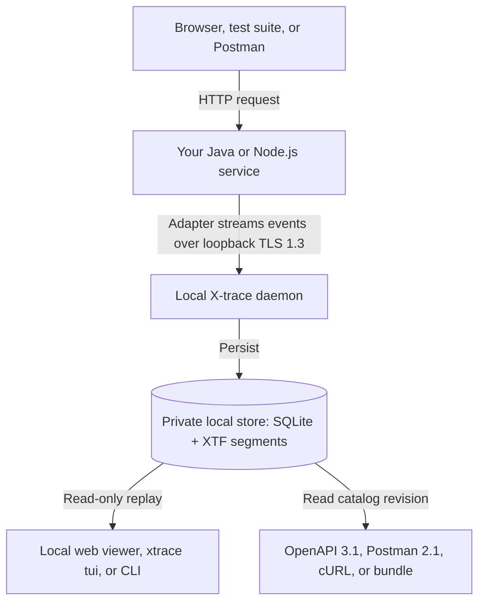

# X-trace

[](https://github.com/Legend101Zz/X-trace/actions/workflows/ci.yml?query=branch%3Amain)
[](https://github.com/Legend101Zz/X-trace/releases/tag/v0.0.1)
[](https://github.com/Legend101Zz/X-trace/releases)
[](LICENSE)

**Follow an HTTP request through your backend, one recorded call at a time.**

X-trace is a local, privacy-first execution recorder for **Java** and **Node.js** services. Instead of scattering temporary `console.log` statements or pausing your server in a debugger, run your backend once under `xtrace run`, hit an endpoint from your browser, test suite, or Postman, and replay the saved execution afterward—in a local web viewer, an interactive terminal UI, or the CLI.

[Demo](#see-it-in-action) · [Install](#installation) · [Quickstart](#quickstart) · [How it works](#how-it-works) · [Supported stacks](#supported-stacks) · [Privacy & security](#privacy--local-first-security) · [Release status](#release-status)

---

## See it in action

Recorded directly in Chromium (`1280×800`) against **Spring Petclinic** running under `xtrace run --capture-depth focused`:


**[Watch / download the full 1280×800 MP4 video (`xtrace-demo.mp4`)](docs/demo/xtrace-demo.mp4)**

| Steps, highlighted Code & Evidence | Map (call relationships) | Export (OpenAPI, Postman, cURL, Bundle) |
| --- | --- | --- |
|  |  |  |

Prefer staying in the terminal? **`xtrace tui`** opens the exact same saved recordings with keyboard stepping (`↑/↓`, `[ ]`, `i / o / u`):

```text
X-trace · recordings
> 01a21ef1-f889-7e2f-9b4b-b67a1dd050f4  complete  329 events  GET /vets               responded
  01a21ef1-f5ef-7d58-a021-07fe615eba18  complete  122 events  GET /owners/{ownerId}   responded
  01a21ef1-f2e3-79d2-a5e0-5bab33cbec95  complete   75 events  POST /owners/new        responded
  01a21ef1-eaa1-7aea-a21d-d0bb95c9c9ab  complete  157 events  GET /owners             responded
```

---

## Why X-trace?

When you're onboarding to an unfamiliar codebase—or chasing down why a `POST /orders` request returned `500` instead of `201`—existing tools each show only one slice of the picture:

- **Logs** only tell you what someone remembered to log.
- **Postman and curl** tell you what went over the wire, not which service method or branch ran.
- **Breakpoints** freeze live traffic and disappear the moment you restart the server.

**X-trace records one real request at a time into a local project store.** You can stop your app, reopen the recording later, step forward and backward through every observed call without re-sending the HTTP request, and—when you've scanned routes—export clean OpenAPI, Postman, or cURL templates straight from your project.

Consider two requests to the same `POST /orders` endpoint in the built-in [Spring fixture](adapters/java/spring-fixture/src/main/java/dev/xtrace/fixture):


Both requests hit the exact same route, yet take different paths through the codebase. X-trace saves both executions so you can compare them side by side.

---

## Installation

### Option 1: Pre-built `v0.0.1` archives (macOS Apple Silicon & Linux x86_64)

Download the archive and `SHA256SUMS` from the **[v0.0.1 Pre-release](https://github.com/Legend101Zz/X-trace/releases/tag/v0.0.1)**, verify the checksum, and run the included installer:

```sh
# 1. Pick your platform: macos-arm64 or linux-x86_64
PLATFORM="macos-arm64"   # or "linux-x86_64"
VERSION="0.0.1"

# 2. Extract and install into ~/.local/xtrace (or pass --prefix /your/path)
tar -xzf "xtrace-${VERSION}-${PLATFORM}.tar.gz"
cd "xtrace-${VERSION}-${PLATFORM}"
./install.sh install

# 3. Add X-trace to your PATH (install.sh never modifies shell profiles automatically) and verify
export PATH="$HOME/.local/xtrace/bin:$PATH"
xtrace --version
```

> **Note:** Both `v0.0.1` preview archives (macOS `arm64` and Linux `x86_64`) are currently unsigned and not notarized. On macOS, if your browser adds a quarantine attribute to the downloaded tarball, run `xattr -dr com.apple.quarantine xtrace-0.0.1-macos-arm64.tar.gz` before extracting. To uninstall at any time, run `./uninstall.sh`.

### Option 2: Build from source

Requires **Rust** (stable, per `rust-toolchain.toml`), a C compiler, **JDK 17+**, and **Node.js 22 or 24**.

```sh
git clone https://github.com/Legend101Zz/X-trace.git
cd X-trace

# Build a deterministic local package for your machine
python3 packaging/build.py --out dist
sh packaging/install.sh verify-dist dist/*

# Or run the CLI directly during development
cargo run --locked -p xtrace-cli --bin xtrace -- --help
```

See [tools/dev/README.md](tools/dev/README.md) and [docs/development/setup.md](docs/development/setup.md#experimental-xtrace-run) for build caches and developer tooling.

---

## Quickstart

### 1. Initialize your application repository

Point X-trace at your app directory once. This writes a lightweight `.xtrace/config.toml` project pointer in the repo while storing all recordings separately in your private X-trace data directory (`XTRACE_DATA_HOME`).

```sh
project_dir="/absolute/path/to/your/app"
xtrace init --project-dir "$project_dir" --display-name "My Service"
```

### 2. Run your backend under X-trace

Start your app normally through `xtrace run`, send requests from your browser, tests, `curl`, or Postman, and press `Ctrl+C` when done. X-trace drains in-flight recordings cleanly on shutdown.

#### Java (Spring MVC, Spring WebFlux, Servlet, Jersey / JAX-RS)

```sh
xtrace_home="$HOME/.local/xtrace/current"

# Optional: statically scan routes first so exports & endpoint grouping work immediately
xtrace scan --project-dir "$project_dir" --source "$project_dir/src/main/java" --framework spring-mvc
# For JAX-RS / Jersey (jakarta.ws.rs or javax.ws.rs), use: --framework jaxrs

# Launch with focused capture (highlights exact executed source lines & bounded local values)
xtrace run --project-dir "$project_dir" \
  --java-agent "$xtrace_home/share/xtrace/packs/java/agent/xtrace-java-agent.jar" \
  --capture-depth focused \
  --app-package com.example.myapp \
  --source-root src/main/java -- \
  java -jar target/myapp.jar
```

#### Node.js (Node 22–24: HTTP, Express 4/5, Fastify 4/5, NestJS, PostgreSQL, MySQL, Outbound HTTP)

```sh
xtrace_home="$HOME/.local/xtrace/current"

xtrace run --project-dir "$project_dir" \
  --node-adapter "$xtrace_home/share/xtrace/packs/node/dist" \
  --node-mode auto -- \
  node dist/server.js
```

*(If you passed a custom `--prefix` to `./install.sh`, set `xtrace_home="<your-prefix>/current"`.)*

### 3. Replay recordings in Chrome, the terminal, or the CLI

```sh
# Open the local browser viewer (Steps, Map, Code, Evidence, Export)
xtrace open --project-dir "$project_dir" --viewer

# Or browse in the interactive terminal viewer (add --plain for non-interactive output)
xtrace tui --project-dir "$project_dir"

# Or query saved recordings as JSON from scripts
xtrace recording list --project-dir "$project_dir"
```

> **Tip:** `xtrace open --viewer` runs in the foreground and prints a short-lived, single-use loopback URL. Keep the terminal running while you explore, and treat the URL like a temporary local credential.

### 4. Export OpenAPI, Postman, cURL, or a Developer Bundle

Always preview first, then write into a fresh private (`0700`) directory:

```sh
xtrace export --project-dir "$project_dir" --format postman --preview

export_dir="$(mktemp -d)" && chmod 700 "$export_dir"
xtrace export --project-dir "$project_dir" --format bundle --output "$export_dir"
ls -la "$export_dir"
```

Supported formats: `openapi` (OpenAPI 3.1), `postman` (Collection v2.1), `curl` (shell recipes), and `bundle` (all three plus a manifest with file hashes and counts).

---

## How it works



X-trace is built around **honest evidence**. Rather than guessing what happened when something wasn't observed, every view tells you exactly what the recording contains:

| What you see | What it guarantees |
| --- | --- |
| **Captured call** | The runtime adapter directly observed that method or handler during this request. Static scan results are shown separately as discovered routes, never disguised as executed calls. |
| **Highlighted source line** | A `line_cursor` event was recorded (`--capture-depth focused` on Java). Method-level capture shows the method without claiming which line ran. |
| **Value or omission** | Focused Java capture records bounded values in your configured `--app-package` scope. Redactions, truncations, and unavailable values are explicitly disclosed. |
| **Partial recording** | Something interrupted capture (for example, a killed process mid-request or an untransformed class). Every captured event remains inspectable with missing parts marked honestly. |

Read more in [Architecture](docs/plans/x-trace/02-architecture.md) and [Recording limitations (ADR 0011)](docs/decisions/0011-recording-limitations.md).

---

## Supported stacks

| Runtime | Frameworks & interactions | Static scan & exports | Source lines & values |
| --- | --- | --- | --- |
| **Java 17 & 21** | Spring MVC, Spring WebFlux, Servlet, Jersey / JAX-RS, JDBC (including PostgreSQL) | `spring-mvc` & `jaxrs` (`jakarta.ws.rs` / `javax.ws.rs`) → OpenAPI 3.1, Postman 2.1, cURL, Bundle | Method-level (standard) + executed lines & bounded local values (`--capture-depth focused`) |
| **Node.js 22 & 24** | `node:http`, Express 4 & 5, Fastify 4 & 5, NestJS, PostgreSQL (`pg`), MySQL (`mysql`/`mysql2`), outbound HTTP/`fetch`, worker & child-process linkage | Planned for upcoming release | Request/framework/DB/outbound frames captured today; source lines & values honestly disclosed as unavailable |

### Using X-trace alongside Postman

- **Need to craft payloads, test headers, or run response assertions?** Start in **Postman**.
- **Need to see which controller, service, repository, or SQL call actually handled that request?** Open the recording in **X-trace**.
- **Using both together:** Send requests from Postman to your instrumented local service, inspect the execution in X-trace, or export a fresh `collection.postman.json` from X-trace (with an empty `baseUrl` variable and zero captured secrets) straight into Postman.

---

## Privacy & local-first security

X-trace is designed for local development on real codebases without leaking sensitive data:

- **100% loopback local:** Zero cloud sync, telemetry, or external network requests. The viewer runs strictly on `127.0.0.1`.
- **Authenticated transport:** Adapters connect to the local daemon over pinned TLS 1.3 with per-session credentials.
- **Private storage by default:** Project stores and exports enforce `0700` directories and `0600` files, refusing world-writable locations.
- **No secrets in exports:** Request bodies, `Authorization` headers, cookies, and query secrets are excluded from exported OpenAPI, Postman, cURL, and bundle files.
- **Continuous canary testing:** Automated real-app campaigns inject synthetic secret canaries across headers, cookies, query strings, JSON bodies, and environment variables and scan every persisted store, log, API response, DOM snapshot, and export surface fail-closed.

See [Local security model](docs/security-local.md) for the full threat model.

---

## Release status

The current release is **`v0.0.1` (Early Preview / Pre-release)** for **macOS Apple Silicon (`macos-arm64`)** and **Linux (`linux-x86_64`)**.

### What's verified today

- **Linux CI (`main`)**: 8/8 required gates passing across JDK 17/21 and Node 22/24, including 23 pinned release-floor gates and deterministic package verification.
- **macOS `arm64`**: `0.0.1` package builds cleanly (`11/11` verifier checks passing, byte-identical embedded UI assets) and runs focused Java & Node capture locally.
- **Real-world application campaigns (hosted Linux CI)**:
  - **Spring Petclinic**: **45/45 checks green** (`1.16×` p50 overhead, 65 recordings, focused source lines & bounded values, all 4 exports, Chromium `320/736/1280 px`, `xtrace tui`, zero privacy leaks) — [Run 46068767524](https://github.com/Legend101Zz/X-trace/actions/runs/46068767524).
  - **JHipster v9.4.0**: 36/45 passing/reported (43 export files / 38 ops, Chromium `320/736/1280 px`, `xtrace tui`, zero leaks).
  - **Apache Fineract 1.15.0**: 30/45 passing/reported (**675 JAX-RS operations** exported across 680 files via `--framework jaxrs`, Chromium `320/736/1280 px`, `xtrace tui`, zero leaks).
  - **Directus (Node 22), Medusa (Node 24), Vendure (Node 24)**: All three capture end-to-end with **100% matching semantic fingerprints**, zero dropped requests (`46/45`, `49/48`, `48/47`), clean shutdown drain, and passing Chromium `320/736/1280 px` viewer journeys — [Run 46071080995](https://github.com/Legend101Zz/X-trace/actions/runs/46071080995).

### What's next on the roadmap

- **Formal `0.0.1` signed acceptance** ([Issue #1](https://github.com/Legend101Zz/X-trace/issues/1) · [Acceptance ledger](evidence/v0.01/requirements.json)): full `macos-release-check.sh` archive, fresh-profile install proofs, human usability sessions, owner walkthrough, and Ed25519 release signing.
- **Node.js source locations & static catalog exports**: source-map-backed file/line bindings and static route scanning for Express/Fastify/NestJS.
- **Java optional-class transform resilience**: eliminating remaining `class_not_transformed` partial-recording counts on large multi-module apps like Fineract and JHipster.

---

## Frequently asked questions

**Does stepping backward in the viewer re-run my HTTP request?**
No. Viewing and stepping through a recording is 100% read-only against the saved SQLite + XTF store. You can safely inspect `POST` or `DELETE` requests even after stopping your server.

**Why does a recording say `Partial`?**
X-trace never pretends an incomplete capture is complete. A recording is marked `Partial` if the app exited or was killed while the request was still in flight, if an event queue reached its memory bound, or if a class could not be instrumented. Click **Why?** in the viewer to see the exact reason.

**Where are recordings stored, and how do I clean them up?**
Your application repository only contains `.xtrace/config.toml` (safe to add to `.gitignore`). The actual SQLite metadata and XTF event segments live in `$XTRACE_DATA_HOME` (defaulting to your OS user data directory). Deleting that project folder removes all recordings cleanly.

---

## Project documentation

- [Product design](docs/plans/x-trace/01-product.md) — workflow goals and replay concepts
- [Architecture](docs/plans/x-trace/02-architecture.md) — daemon, XTP transport, XTF storage, and adapters
- [Local security model](docs/security-local.md) — loopback TLS, permissions, and privacy guarantees
- [Developer setup & build tools](tools/dev/README.md) — local prerequisites, caches, and verification commands
- [Release specification (`v0.01`)](docs/releases/v0.01.md) — platform, runtime, and evidence commitments
- [Owner review checklist](docs/owner-review/README.md) — Stage C manual walkthrough journeys
- [Full documentation index](docs/INDEX.md) — schemas, protocol specs, viewer API, and ADRs

---

## License

X-trace is open-source software licensed under the [MIT License](LICENSE).
