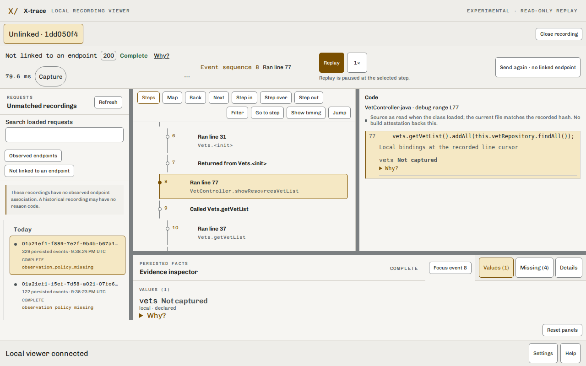
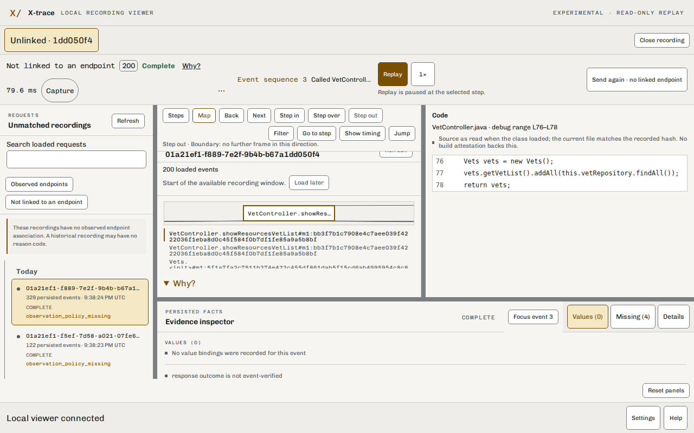
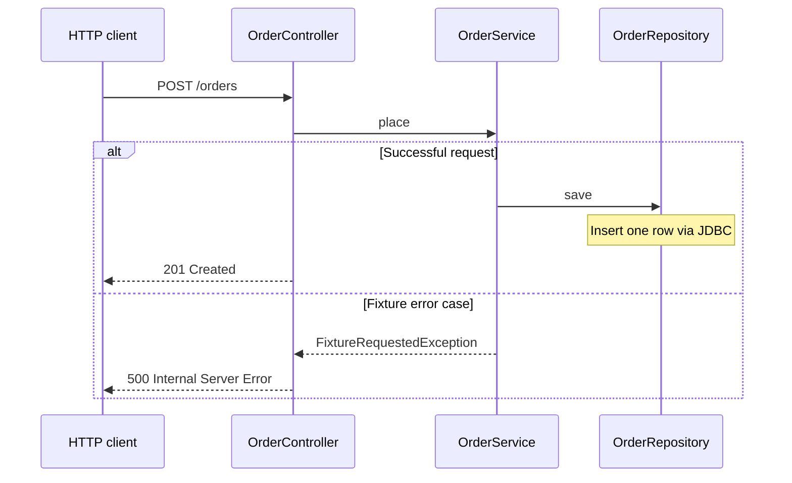
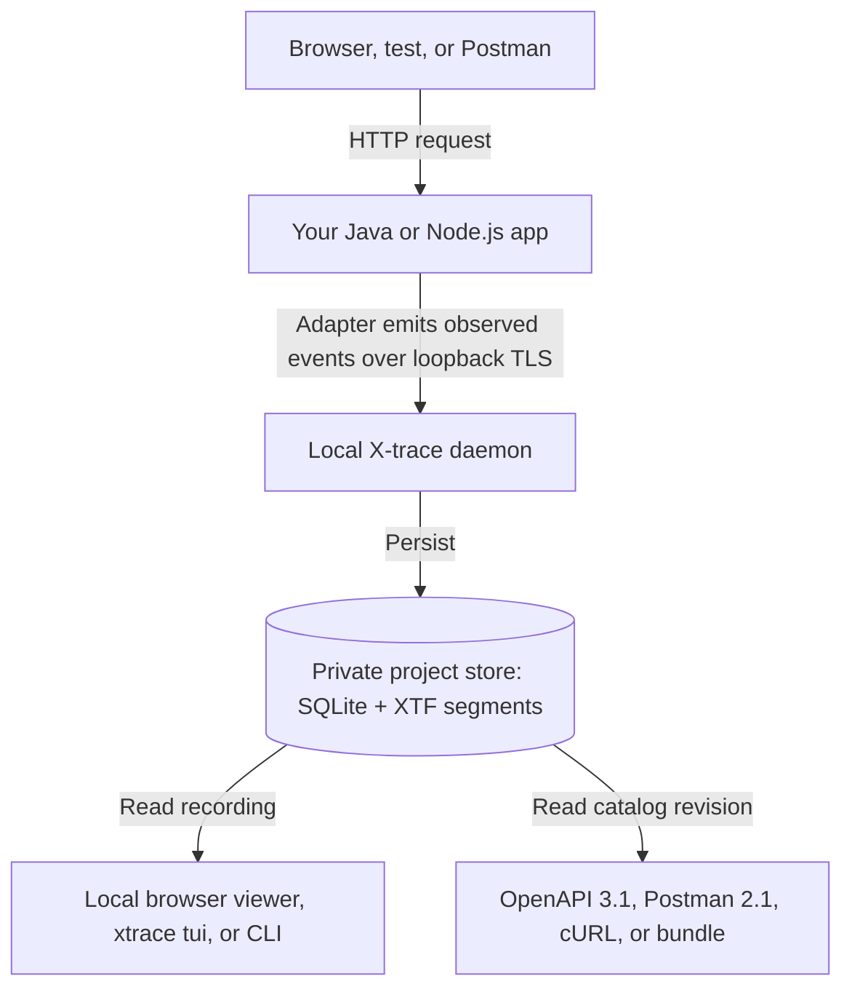

# X-trace

[](https://github.com/Legend101Zz/X-trace/actions/workflows/ci.yml?query=branch%3Amain)
[](docs/releases/v0.01.md)
[](LICENSE)

**Follow an HTTP request through your backend, one recorded call at a time.** X-trace is a local, privacy-first development tool for **Java** and **Node.js** backends. Send a request from a browser, a test, or Postman, then open its saved recording in the local viewer or terminal UI to see which handler ran, which methods and source lines executed, what interactions followed, and what outcome was observed.

[Watch the demo](#see-it-in-action) · [Quickstart](#how-to-use-x-trace) · [Release status](#release-status) · [Documentation](#project-documentation)

## See it in action

Recorded directly in Chromium (`1280×800`) against Spring Petclinic running under `xtrace run --capture-depth focused`:


**[Download / watch full 1280×800 MP4 video (`xtrace-demo.mp4`)](docs/demo/xtrace-demo.mp4)**

| Steps, highlighted Code & Evidence | Map (call relationships) | Export (OpenAPI, Postman, cURL, Bundle) |
| --- | --- | --- |
|  |  |  |

Prefer the terminal? Open the exact same recordings in **`xtrace tui`**:

```text
X-trace · recordings
> 01a21ef1-f889-7e2f-9b4b-b67a1dd050f4  complete  329 events  GET /vets               responded
  01a21ef1-f5ef-7d58-a021-07fe615eba18  complete  122 events  GET /owners/{ownerId}   responded
  01a21ef1-f2e3-79d2-a5e0-5bab33cbec95  complete   75 events  POST /owners/new        responded
  01a21ef1-eaa1-7aea-a21d-d0bb95c9c9ab  complete  157 events  GET /owners             responded
```

## What problem does it solve?

An endpoint list can tell you that `POST /orders` exists. A response can tell you it returned `201`. When you're new to a codebase or debugging an unexpected status code, the harder question is **which code actually handled this request?** The route definition, controller, service, repository, and error handler often live in different files. A recording gives you one persisted execution to step through after the request has finished.

The repository includes a small Spring application that makes this concrete. On a successful order, its controller calls a service, the service calls a repository, and the repository inserts a row through JDBC. Its error case returns `500` from the controller after a service exception. Those two requests reach the same endpoint and take different paths. [Fixture source](adapters/java/spring-fixture/src/main/java/dev/xtrace/fixture) · [Capture journey](crates/xtrace-cli/tests/java_premain_spring.rs)



## What does a recording show?

Choose a request in the local viewer and step through its events. **Steps** displays them in order with keyboard navigation (`Alt+↑/↓`, Step in / over / out). **Map** shows their recorded call relationships. The terminal viewer (`xtrace tui`) and CLI also read saved recordings. You can reopen any recording after stopping the application.

| In the viewer | How to read it |
| --- | --- |
| A captured call | The adapter observed that call during this request. A route found by a static scan alone says only that the route was discovered. |
| A highlighted source line | The recording contains a line event (`--capture-depth focused` on Java). Method-level capture identifies the method without claiming which line executed. |
| A value or an omission | Focused Java capture includes bounded values from the selected application scope. Redaction, truncation, and unavailable source or values are disclosed explicitly. |
| A partial recording | Some evidence is missing (for example, a process killed mid-request or an untransformed class). You can inspect every captured event while leaving missing steps clearly disclosed. |

The application adapter sends events over pinned loopback TLS to the local X-trace daemon, which persists them in your private project store. Viewing a recording reads that stored evidence; stepping backward never replays the original HTTP request. [Architecture](docs/plans/x-trace/02-architecture.md) · [Recording limitations](docs/decisions/0011-recording-limitations.md) · [Local security model](docs/security-local.md)



## How does X-trace fit with Postman?

| Question | Where to start |
| --- | --- |
| What happens if I send this payload or change a header? | **Postman.** Build and send the request, inspect the response, and write assertions against it. |
| Which application method and source line handled that request? | **X-trace.** Open the recording for your instrumented local service and inspect the observed calls, source evidence, and outcome. |
| How can I repeat a case and explain a surprising result? | **Use both.** Send requests from Postman (or tests) to your running instrumented service, then inspect the resulting recording in X-trace. |

You can also go from X-trace to Postman. With a persisted catalog revision (`xtrace scan`), export a local Collection v2.1 file, import `collection.postman.json` into Postman, and set its empty `baseUrl` variable to your local service. Exports contain request templates only — captured request bodies, cookies, and credentials are never exported. [X-trace collection exporter](crates/xtrace-export/src/postman.rs)

## How to use X-trace

Start in the X-trace checkout on macOS or Linux (or use a candidate `0.0.1` archive built by `packaging/build.py`). From source, replace `xtrace` below with `cargo run --locked -p xtrace-cli --bin xtrace --`. [Setup guide](docs/development/setup.md#experimental-xtrace-run) · [Build environment](tools/dev/README.md)

### 1. Initialize your application repository

Creates a local `.xtrace/config.toml` pointer in your app repo; recordings stay in your private X-trace data directory (`XTRACE_DATA_HOME`).

```sh
project_dir="/absolute/path/to/your/app"
xtrace init --project-dir "$project_dir" --display-name "My Service"
```

### 2. Optional: Scan routes statically (Java Spring MVC or JAX-RS)

Persist an endpoint catalog revision so recordings can link to discovered routes and exports are immediately available:

```sh
# Spring MVC
xtrace scan --project-dir "$project_dir" --source "$project_dir/src/main/java" --framework spring-mvc

# JAX-RS / Jersey (jakarta.ws.rs & javax.ws.rs)
xtrace scan --project-dir "$project_dir" --source "$project_dir/src/main/java" --framework jaxrs
```

### 3. Run your backend with X-trace

Send normal HTTP traffic from your browser, tests, `curl`, or Postman while the service runs, then stop with `Ctrl+C` (X-trace drains in-flight recordings cleanly on shutdown):

```sh
# Java (Spring MVC, Spring WebFlux, Servlet, Jersey / JAX-RS)
# Add `--capture-depth focused` for executed source lines and bounded local values.
xtrace run --project-dir "$project_dir" \
  --java-agent /path/to/xtrace-java-agent.jar \
  --capture-depth focused \
  --app-package com.example.myapp \
  --source-root src/main/java -- \
  java -jar target/myapp.jar
```

```sh
# Node.js 22–24 (node:http, Express 4/5, Fastify 4/5, NestJS, pg, mysql/mysql2, outbound HTTP)
xtrace run --project-dir "$project_dir" \
  --node-adapter /path/to/packs/node/dist \
  --node-mode auto -- \
  node dist/server.js
```

### 4. Inspect recordings in the browser, TUI, or CLI

The browser viewer prints a short-lived, single-use loopback URL and stays in the foreground. Treat the viewer URL as a temporary local credential.

```sh
# Local browser viewer (Steps, Map, Code, Evidence, Export)
xtrace open --project-dir "$project_dir" --viewer

# Interactive terminal viewer (or add `--plain` for non-interactive output)
xtrace tui --project-dir "$project_dir"

# CLI listing and JSON detail
xtrace recording list --project-dir "$project_dir"
```

### 5. Export OpenAPI, Postman, cURL, or a Developer Bundle

Always preview before writing to a fresh private output directory:

```sh
xtrace export --project-dir "$project_dir" --format postman --preview
export_dir="$(mktemp -d)"
xtrace export --project-dir "$project_dir" --format bundle --output "$export_dir"
```

## Release status

The first public release target is **v0.01** (package version **0.0.1**). Core product implementation for Java, Node.js, the v2 Simple browser viewer, the interactive TUI, static route scanners, and all four local export formats has merged to `main` and passed Linux CI (`69e3d02`). Formal acceptance across all 55 mandatory requirements awaits final owner Stage C sign-off (macOS arm64 verification, fresh installs, usability sessions, cross-vendor review, and Ed25519 release signing). [Release tracker](https://github.com/Legend101Zz/X-trace/issues/1) · [Acceptance ledger](evidence/v0.01/requirements.json) · [Published releases](https://github.com/Legend101Zz/X-trace/releases)

| Area | Implemented and verified on Linux CI | Remaining for formal 0.0.1 acceptance |
| --- | --- | --- |
| **Java** | Spring MVC, Spring WebFlux, Servlet/Jersey capture; focused executed lines & bounded values; `spring-mvc` and `jaxrs` (`jakarta.ws.rs` / `javax.ws.rs`) static analyzers; graceful shutdown. **Spring Petclinic**: **45/45** checks green (`1.16×` p50 overhead, zero privacy leaks). **JHipster v9.4.0**: 36/45 passing/reported (43 export files, 7/8 scenarios). **Apache Fineract 1.15.0**: 30/45 passing/reported (675 JAX-RS operations exported across OpenAPI, Postman, cURL & bundle). | Remaining JHipster/Fineract class-transformation gaps on optional classes and full 45/45 green gates on those two apps. |
| **Node.js** | `node:http`, Express 4/5, Fastify 4/5, NestJS, PostgreSQL (`pg`), MySQL (`mysql`/`mysql2`), outbound HTTP/fetch, process linkage, and bounded `10s` graceful shutdown drain & burst capacity. **Directus** (46 recordings), **Medusa** (49 recordings), and **Vendure** (48 recordings) all capture with 100% matching semantic fingerprints, zero dropped requests, clean shutdown, and passing Chromium viewer checks. | Node frame source locations (`source_locations_unavailable`), focused values (`values_unavailable`), and Node static catalog export wiring (all honestly disclosed today). |
| **Viewer, TUI & Exports** | Local v2 Simple browser viewer (`Steps`, `Map`, `Code`, `Evidence`, `Export` modal; verified in Chromium at `320 / 736 / 1280 px`), interactive `xtrace tui` PTY replay, and OpenAPI 3.1 / Postman 2.1 / cURL / Bundle exports with zero secret leakage. | Usability sessions and final owner UI walkthrough. |
| **Distribution & Signing** | Linux `x86_64` `0.0.1` candidate archive built and verified (`package.yml`, `package-verification.json: ok`), automated Chromium demo recorder (`demo-video.yml`). | macOS `arm64` release check & archive, fresh Mac/Linux install proofs, cross-vendor review sign-off, and Ed25519 release signing. |

**Latest verified CI runs:** [Linux package `0.0.1` on `69e3d02`](https://github.com/Legend101Zz/X-trace/actions/runs/46068763422) · [Java campaigns (Petclinic 45/45, JHipster, Fineract)](https://github.com/Legend101Zz/X-trace/actions/runs/46068767524) · [Node campaigns (Directus, Medusa, Vendure)](https://github.com/Legend101Zz/X-trace/actions/runs/46071080995) · [Chromium demo walkthrough](https://github.com/Legend101Zz/X-trace/actions/runs/46071076492)

## Project documentation

- [Product design](docs/plans/x-trace/01-product.md) describes the endpoint-to-source workflow.
- [Development tools](tools/dev/README.md) covers dependencies, build caches, and local checks.
- [Release specification](docs/releases/v0.01.md) lists the runtime, platform, and usability commitments.
- [Owner review guide](docs/owner-review/README.md) walks through final Stage C release acceptance.
- [Documentation index](docs/INDEX.md) links the storage format, protocol, viewer API, and architecture decision records.

X-trace uses the [MIT license](LICENSE).
